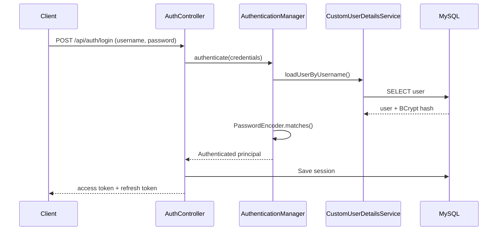
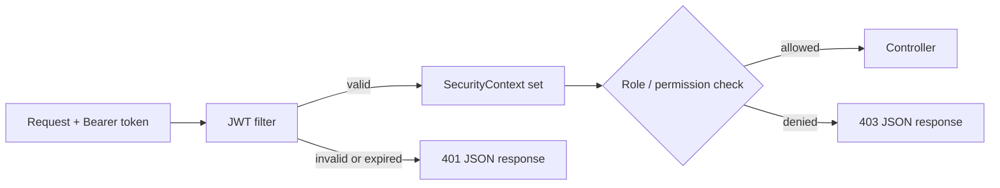

# Spring Security Complete Guide: Production-Style Auth & Authorization API

A hands-on, end-to-end implementation of **Spring Security 7** on **Spring Boot 4** and **Java 21**. It covers the full lifecycle of a secure backend: user registration, `AuthenticationManager` login, JWT access and refresh tokens, database-backed sessions, and role- and permission-based access control.

Built to demonstrate how real-world authentication and authorization systems are designed, not just how to make them work.


---

## Highlights

- **Stateless JWT authentication** with short-lived access tokens and rotating refresh tokens
- **Server-side session tracking in MySQL**, so tokens can be revoked, listed and expired on demand
- **Role-based (RBAC) and permission-based authorization**, enforced at both URL level and method level
- **Clean layered architecture**: controller, service, repository, DTOs, entities
- **Consistent, secure error handling** for every JWT failure case (expired, malformed, tampered, revoked)
- **Passwords stored only as BCrypt hashes**; no plain text, no reversible encryption
- **DTO-based API design**, so entities and password hashes never leak into responses

---

## Feature checklist

### Core authentication
- [x] User registration with validation and duplicate checks
- [x] BCrypt password hashing via `PasswordEncoder`
- [x] Custom `UserDetailsService` backed by MySQL
- [ ] Login endpoint using `AuthenticationManager`
- [ ] Account status handling (enabled, locked, expired)

### JWT & tokens
- [ ] Access token generation and signing
- [ ] Access token verification filter (`OncePerRequestFilter`)
- [ ] Refresh token flow and token rotation
- [ ] Custom handling of JWT exceptions (expired, invalid signature, malformed, unsupported)
- [ ] Logout and token revocation

### Session management
- [ ] Sessions persisted in the database
- [ ] Multi-device sessions per user
- [ ] View and revoke active sessions
- [ ] Automatic cleanup of expired sessions

### Authorization
- [ ] URL-level rules with `requestMatchers`
- [ ] Role-based access control (RBAC)
- [ ] Fine-grained authorities and permissions
- [ ] Method security: `@PreAuthorize`, `@PostAuthorize`, `@Secured`
- [ ] Custom `AuthenticationEntryPoint` and `AccessDeniedHandler` (clean 401 and 403 JSON)

### Quality
- [ ] Global exception handling with `@RestControllerAdvice`
- [ ] Unit and integration tests with Spring Security Test
- [ ] API documentation with OpenAPI / Swagger

---

## Tech stack

| Layer | Technology |
|---|---|
| Language | Java 21 |
| Framework | Spring Boot 4.1.1, Spring Web MVC |
| Security | Spring Security 7, JWT |
| Persistence | Spring Data JPA, Hibernate, MySQL 8 |
| Mapping | ModelMapper |
| Utilities | Lombok |
| Build tool | Maven |

---

## Architecture

```text
com.security.SpringSecurityApplication
├── config          # SecurityFilterChain, beans (PasswordEncoder, AuthenticationManager)
├── controllers     # REST endpoints
├── services        # Service interfaces
├── serviceImpl     # Business logic
├── repositories    # Spring Data JPA repositories
├── entities        # JPA entities (users, roles, sessions)
├── requestDTO      # Incoming payloads
├── responseDTO     # Outgoing payloads (no sensitive fields)
└── security        # JWT utilities, filters, handlers
```

### Authentication flow



### Request authorization flow



---

## API overview

> Endpoints are listed as planned and will be updated as each feature lands.

| Method | Endpoint | Access | Description |
|---|---|---|---|
| POST | `/api/user/create` | Public | Register a new user |
| POST | `/api/auth/login` | Public | Authenticate and receive tokens |
| POST | `/api/auth/refresh` | Public (valid refresh token) | Issue a new access token |
| POST | `/api/auth/logout` | Authenticated | Revoke the current session |
| GET | `/api/sessions` | Authenticated | List the user's active sessions |
| DELETE | `/api/sessions/{id}` | Authenticated | Revoke a specific session |
| GET | `/api/user/me` | USER, ADMIN | Current user profile |
| GET | `/api/admin/**` | ADMIN | Admin-only resources |

---

## Getting started

### Prerequisites
- Java 21
- Maven 3.9+
- MySQL 8

### 1. Clone the repository
```bash
git clone https://github.com/YOUR_USERNAME/YOUR_REPO.git
cd YOUR_REPO
```

### 2. Create the database
```sql
CREATE DATABASE spring_security;
```

### 3. Configure the application
Edit `src/main/resources/application.properties`:
```properties
spring.datasource.url=jdbc:mysql://localhost:3306/spring_security
spring.datasource.username=YOUR_DB_USER
spring.datasource.password=YOUR_DB_PASSWORD
spring.jpa.hibernate.ddl-auto=update
```
Keep real credentials and the JWT secret out of version control. Use environment variables or a local, git-ignored properties file.

### 4. Run
```bash
./mvnw spring-boot:run
```
The API starts on `http://localhost:8080`.

### 5. Try it
```bash
curl --location 'http://localhost:8080/api/user/create' \
--header 'Content-Type: application/json' \
--data-raw '{"username":"demo","email":"demo@example.com","password":"StrongPass123"}'
```

---

## Security design decisions

- **Passwords:** hashed with BCrypt (salted, adaptive cost). Raw passwords are never stored or logged.
- **Access tokens:** short-lived, so a leaked token has a small window of use.
- **Refresh tokens:** stored server-side and rotated on use, so they can be revoked.
- **Generic login errors:** unknown user and wrong password return the same response, preventing username enumeration.
- **Least privilege:** endpoints are denied by default (`anyRequest().authenticated()`) and opened explicitly.
- **No entity exposure:** responses use DTOs, so password hashes and internal fields never leave the server.

---

## What this project demonstrates

- How the Spring Security filter chain works and how to customize it
- The role of `AuthenticationManager`, `UserDetailsService` and `PasswordEncoder`
- Designing stateless authentication without losing the ability to revoke access
- Implementing RBAC and fine-grained permissions at URL and method level
- Writing secure, testable, maintainable backend code

---

## Roadmap

- [ ] OAuth2 / social login
- [ ] Two-factor authentication
- [ ] Rate limiting and account lockout
- [ ] Docker and docker-compose setup
- [ ] CI pipeline with GitHub Actions

---

## Author

**YOUR NAME**
[LinkedIn](https://linkedin.com/in/YOUR_PROFILE) · [GitHub](https://github.com/YOUR_USERNAME) · your.email@example.com

If this project helped you, consider giving it a star.
